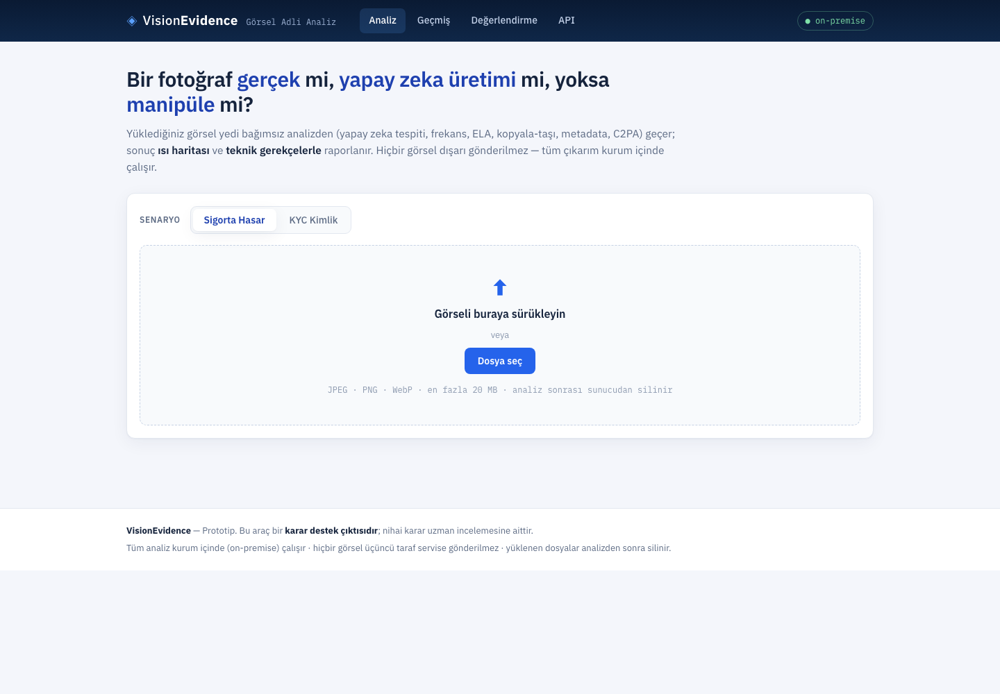
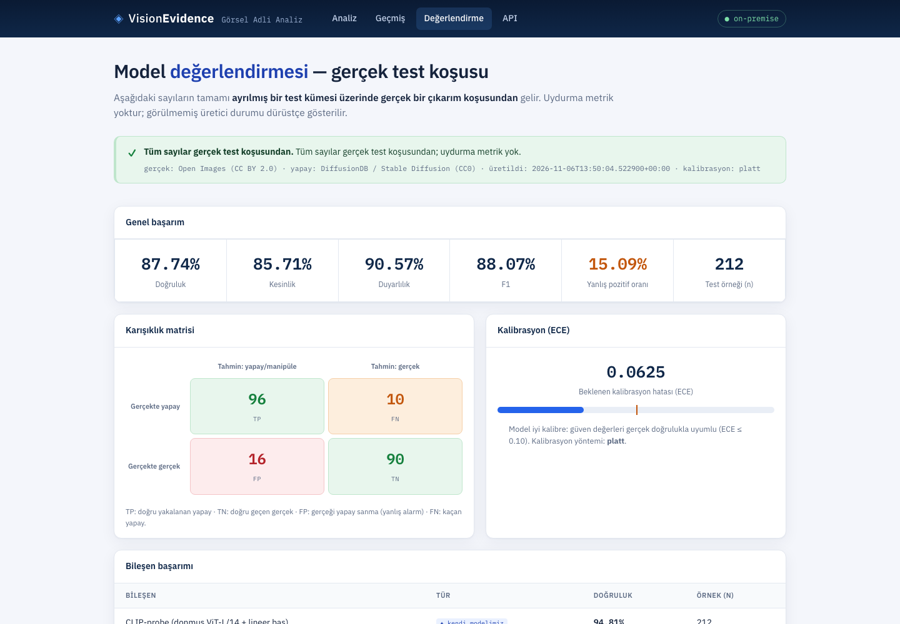
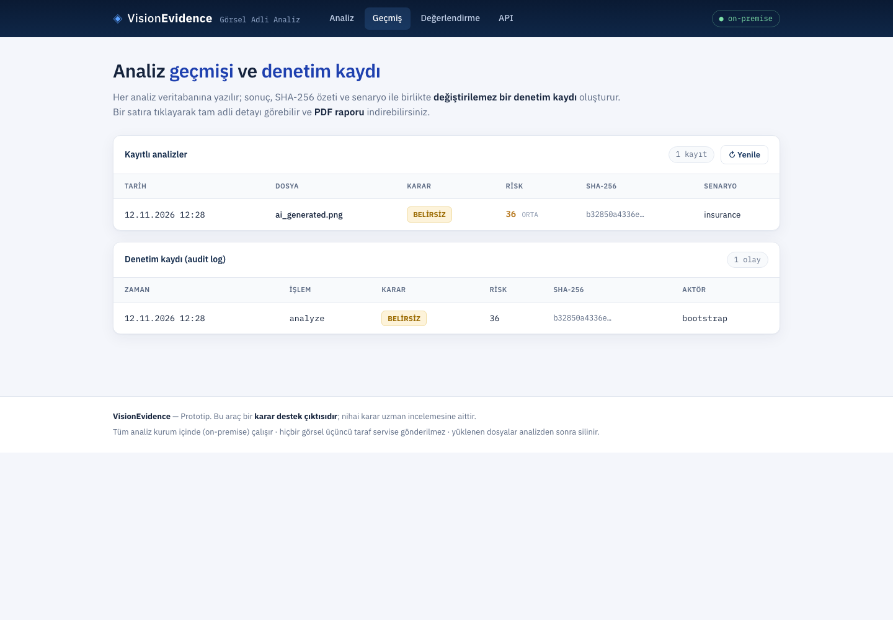
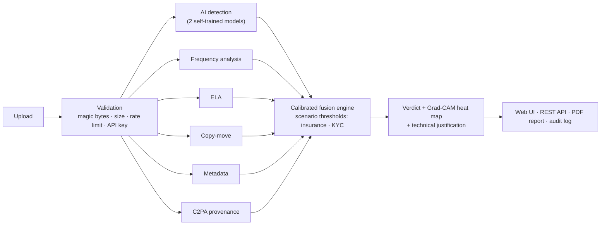

# VisionEvidence — forensic image analysis (case study)

**Is this image real, AI-generated, or manipulated?** VisionEvidence is an on-premise forensic image-analysis platform: seven independent analyzers — two of them models I trained myself — combined by a calibrated fusion engine that reports a verdict with a heat map and technical justification, and is explicitly allowed to say *"uncertain"*.

> **Source is private** — this is a commercial R&D product in active development; this repository documents the architecture and verified results. A live walkthrough of the codebase is available in interviews, and commercial licensing inquiries are welcome via [yigittuzcu.com](https://www.yigittuzcu.com).

| Analysis | Evaluation | History |
|---|---|---|
|  |  |  |

## The problem

Insurance claims and KYC onboarding increasingly receive images that are AI-generated or digitally manipulated. Cloud detection APIs are a non-starter for this material — claim photos and identity documents cannot leave the organization. The system therefore runs **fully on-premise / air-gapped**: no image ever leaves the deployment, originals are deleted immediately after analysis, and derived artifacts expire after 24 hours.

## How it works

- **Seven independent analyzers**, each producing its own evidence; the fusion engine weighs them with **scenario-specific decision thresholds** (an insurance-claim workflow and a KYC-identity workflow tolerate different error types).
- **Two self-trained models**: a CLIP ViT-L/14 linear probe and a fine-tuned EfficientNet-B0, fused with **Platt-calibrated confidence** — when they disagree, the verdict is UNCERTAIN, by design.
- **Explainability built in**: Grad-CAM heat maps show *where* the model looked; every verdict ships with per-analyzer technical justifications, in the UI and in the generated PDF report.
- **Enterprise layer**: API-key auth with a bootstrap-open mode, per-minute rate limiting, magic-byte upload validation, SQLAlchemy-backed audit log, privacy-first retention policy.

## Verified results

All numbers come from real evaluation runs on a held-out set (n = 212; AI class: Stable Diffusion via DiffusionDB CC0, real class: Open Images) — no invented metrics.

| Metric (fusion, held-out) | Value |
|---|---|
| Accuracy | **87.7%** |
| F1 | 0.881 |
| Recall on AI class | 90.6% |
| False-positive rate | 15.1% |
| Calibration error (ECE, Platt) | **0.0625** |

| Component | Accuracy |
|---|---|
| CLIP ViT-L/14 linear probe (self-trained) | **94.8%** |
| Fine-tuned EfficientNet-B0 (self-trained) | 85.9% |

Robustness: accuracy holds at **87.3% under JPEG-70 recompression** and 87.7% on screenshots of the image. Evaluation against unseen generators (e.g. FLUX) is pending and is tracked as such — the honest answer today is that the system reports lower confidence outside its training distribution, which is exactly what the UNCERTAIN verdict is for.

## Engineering decisions I'd defend

1. **Calibration over bravado.** A forensic tool that is confidently wrong is worse than useless. Platt scaling plus an explicit UNCERTAIN verdict turned "the model says 51%" into an actionable three-way decision.
2. **Fusion over a single model.** The CLIP probe is the strongest single component, but frequency/ELA/copy-move/metadata/C2PA evidence catches classes of manipulation a classifier never sees — and provides the justification text that makes verdicts auditable.
3. **On-premise as a feature, not a limitation.** Deleting originals immediately and keeping inference local is the reason the tool is usable on insurance and identity material at all.
4. **Honest metrics as product discipline.** Every number in the UI, the PDF reports and this document is read from the evaluation pipeline's `metrics.json` — the demo rule is *"show whatever the system decides."*

## Stack

Python · FastAPI · PyTorch (CPU / MPS / CUDA) · CLIP ViT-L/14 · EfficientNet-B0 · SQLAlchemy · ReportLab (PDF) · Docker — fully offline after first model download. 30 self-contained automated tests (synthetic fixtures, no external downloads).

## Status

In active development toward commercial deployment. Source and trained weights are private; architecture, screenshots and verified metrics are documented here. Contact: [yigittuzcu.com](https://www.yigittuzcu.com).
